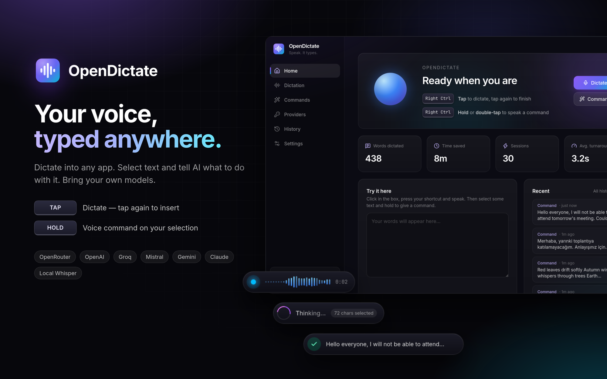
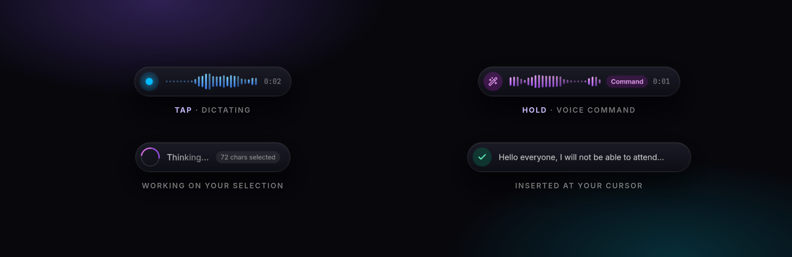
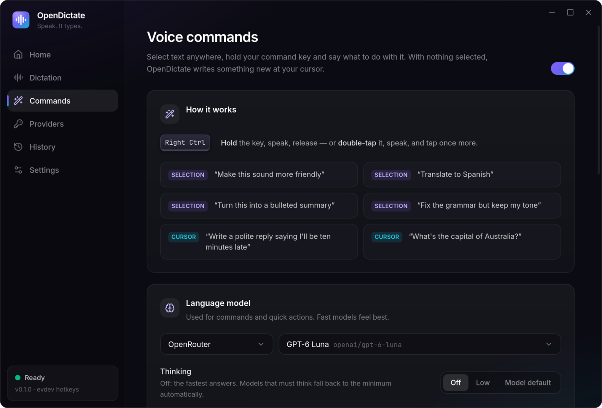
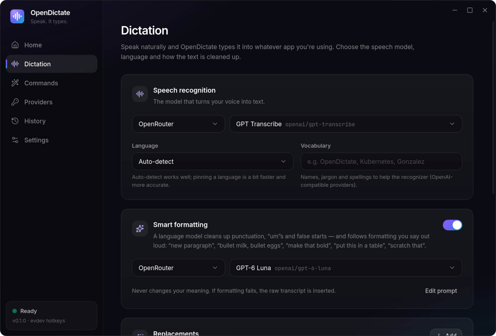
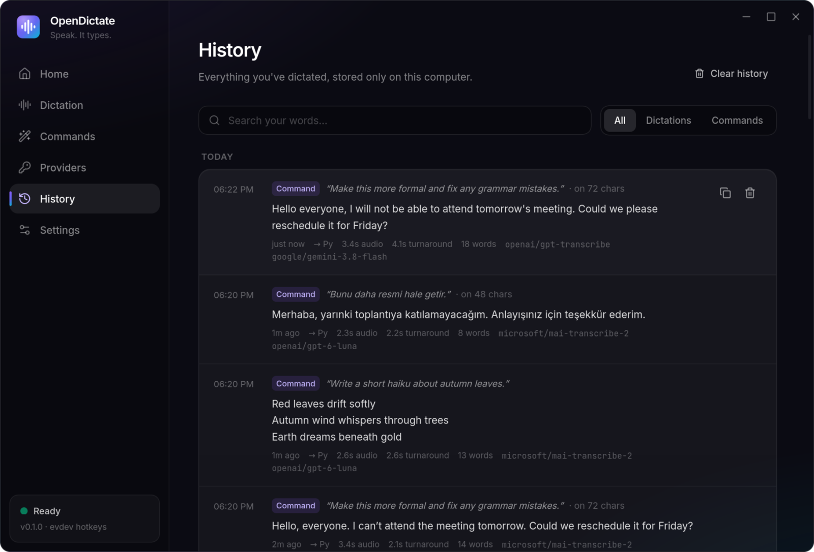
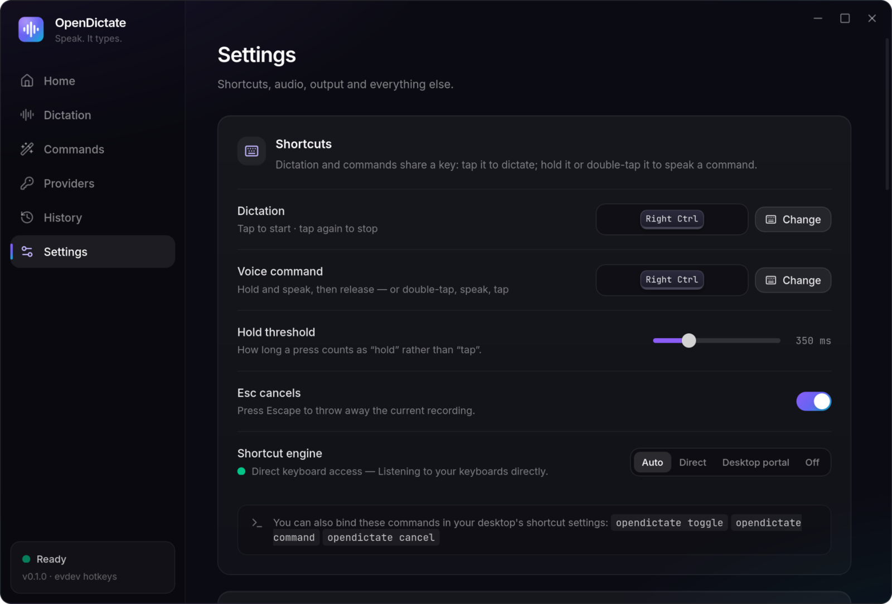

<div align="center">


# OpenDictate

**Your voice, typed anywhere.**

Tap a key to dictate into any app. Hold it to tell AI what to do with the text you've selected.<br/>
Open source, private by design, and powered by the models *you* choose.

[](https://github.com/burakgon/opendictate-desktop/releases/latest)
[](LICENSE)
[](#install)
[](https://github.com/burakgon/opendictate-desktop/actions)
[](https://github.com/burakgon/opendictate-desktop/stargazers)



[**Download**](https://github.com/burakgon/opendictate-desktop/releases/latest) · [Features](#features) · [How it works](#how-it-works) · [Providers](#providers--models) · [Linux setup](#linux-setup) · [FAQ](#faq)

</div>

---

OpenDictate brings the workflow of the Android keyboard [Dictate](https://github.com/DevEmperor/DictateKeyboard) to the desktop: a single key that **types what you say** — and, when you hold it, **does what you say** to the text you've selected. *“Make this more formal.” “Translate to Spanish.” “Turn this into bullet points.”* With nothing selected, it writes something new at your cursor: *“Draft a polite reply saying I'll be ten minutes late.”*

It works in every app — your browser, editor, terminal, chat, email — because it simply pastes at your cursor like you would. There's no account, no subscription and no telemetry: you plug in an API key from OpenRouter, OpenAI, Groq or any OpenAI-compatible server (including a local Whisper), and your words go straight from your machine to the provider you picked.

## Features

- 🎙️ **Dictation everywhere.** Tap your hotkey, speak, tap again — the text appears at your cursor in any application.
- 🪄 **Voice commands on your selection.** Hold the key (or double-tap it) and say what to do: rewrite, translate, summarize, fix grammar, change tone, extract action items, explain…
- ✍️ **Generate at the cursor.** With nothing selected, a command writes new text: emails, replies, snippets, answers.
- ⚡ **Fast.** About a second from “stop talking” to “text appears” — connections are pre-warmed while you speak, silence is trimmed, audio is sent as compact 16 kHz WAV, and models are asked not to “think” (stepping up automatically when a model insists).
- 🧠 **Bring your own models.** OpenRouter (hundreds of models with one key), OpenAI, Groq, Mistral, Google Gemini, Anthropic, or any OpenAI-compatible endpoint — local Whisper servers, LM Studio, Ollama, vLLM.
- ✨ **Formatting you can say.** Optional smart formatting cleans up punctuation, “um”s and false starts, and follows spoken instructions in any language: “new paragraph”, “bullet milk, bullet eggs”, “make that bold”, “put this in a table”, “scratch that”.
- 🗣️ **Command word.** Start a normal dictation with a word of your choice — *“Jarvis, make this formal”* — and it runs as a command.
- 🔁 **Keep talking.** Start the next dictation while the previous one is still being processed; results are typed in the order you spoke.
- 🖥️ **Terminal-aware.** Detects when a terminal has focus (Konsole, GNOME Terminal, kitty, Alacritty, Ghostty, WezTerm, …) and pastes with <kbd>Ctrl</kbd>+<kbd>Shift</kbd>+<kbd>V</kbd> — perfect for dictating prompts to CLI tools.
- 🛟 **Never lose your words.** If a transcription fails (say, your Wi-Fi drops), the recording is kept and can be retried with one click.
- ⚙️ **Quick actions.** One-click prompts like *Fix grammar*, *Make formal* or *Translate to English* for the selected text — from the tray, the app, or the CLI.
- 🫧 **A gorgeous, unobtrusive overlay.** A floating pill with a live waveform that never steals focus. On Wayland it's a true layer-shell surface.
- 🔒 **Private by design.** Keys, settings and history stay on your computer. No telemetry. Temporary clipboard contents are marked so clipboard managers don't record them, and your clipboard is restored after pasting.
- 🐧 **First-class Linux.** Wayland (KDE Plasma, GNOME, Hyprland, Sway, …) and X11. Use *any* key — even a lone **Right Ctrl**, a mouse side button, or the new **Copilot key**.
- 📝 **History & stats.** Search everything you've dictated; see words dictated and time saved.
- 🧩 **Scriptable.** `opendictate toggle`, `opendictate command`, `opendictate action fix` — bind them anywhere.

<div align="center">

</div>

## How it works

| Gesture | What happens |
| --- | --- |
| **Tap** the key | Start dictating. Tap again to stop — the text is typed at your cursor. |
| **Hold** the key | Speak a command, release to run it on the selected text (or to write something new). |
| **Double-tap** the key | Same as hold — handy for keys that can't be held, like the Copilot key. |
| <kbd>Esc</kbd> | Cancel the current recording or request. |

The default key is <kbd>Right Ctrl</kbd> on Linux, <kbd>⌥ Space</kbd> on macOS and <kbd>Ctrl</kbd>+<kbd>Alt</kbd>+<kbd>Space</kbd> on Windows. You can pick any key — or separate keys for dictation and commands, each in *toggle*, *hold* or *tap-or-hold* mode.

**Examples of voice commands**

| With text selected | With nothing selected |
| --- | --- |
| “Make this sound friendlier” | “Write a short thank-you note to the team” |
| “Translate to German” | “What's the capital of Australia?” |
| “Fix the grammar but keep my tone” | “Give me a regex that matches an email address” |
| “Summarize in three bullet points” | “Draft a polite reply saying I'll be ten minutes late” |

## Install

Grab the latest build from the [**Releases page**](https://github.com/burakgon/opendictate-desktop/releases/latest).

| Platform | Package |
| --- | --- |
| **Linux** | `.AppImage` (any distro) · `.deb` (Ubuntu, Debian, Mint, Pop!_OS) · `.rpm` (Fedora, openSUSE) |
| **macOS** | `.dmg` (Apple Silicon and Intel) |
| **Windows** | `-setup.exe` |

On first launch a short setup guides you through adding an API key, checking your microphone and trying your shortcut. OpenDictate then lives in your system tray.

> [!NOTE]
> Linux is the primary, battle-tested platform. macOS and Windows builds are produced by CI from the same code — feedback and bug reports are very welcome.
>
> **macOS:** the app isn't notarized yet. Open it once with right-click → *Open*, then allow **Microphone** and **Accessibility** access (needed to paste into other apps).

### Linux setup

OpenDictate needs two things that Linux protects for good reasons, and the app offers a **one-click fix** for both (*Settings → Linux permissions*, or the first-run setup). It installs a small udev rule that gives **the user sitting at the computer** (via systemd-logind's `uaccess`) access to:

1. **`/dev/uinput`**, a virtual keyboard to paste into other apps. Many desktops already allow this.
2. **`/dev/input`**, to see your shortcut key. This is what makes single-key shortcuts (a lone Right Ctrl, a mouse side button) and true hold-to-talk possible.

It takes effect immediately, no log-out needed.

Prefer not to grant keyboard access? Choose **Desktop portal** as the shortcut engine: shortcuts are registered with KDE Plasma / GNOME 48+ / Hyprland through the XDG GlobalShortcuts portal (key combinations only). Or bind `opendictate toggle` in your desktop's own shortcut settings.

<details>
<summary>Manual setup commands</summary>

```sh
printf '%s\n' \
  'KERNEL=="uinput", SUBSYSTEM=="misc", TAG+="uaccess", OPTIONS+="static_node=uinput"' \
  'KERNEL=="event*", SUBSYSTEM=="input", TAG+="uaccess"' \
  | sudo tee /etc/udev/rules.d/70-opendictate.rules
echo uinput | sudo tee /etc/modules-load.d/opendictate-uinput.conf
sudo modprobe uinput
sudo udevadm control --reload-rules
sudo udevadm trigger --subsystem-match=input --subsystem-match=misc --action=change
```

The file name must sort before `73-seat-late.rules`. Alternatively, add yourself to the `input` group and log in again.

The floating overlay uses [`gtk-layer-shell`](https://github.com/wmww/gtk-layer-shell) when it's installed (`gtk-layer-shell` on Arch/Fedora, `libgtk-layer-shell0` on Debian/Ubuntu).
</details>

## Providers & models

You only need **one** key. [OpenRouter](https://openrouter.ai/keys) is the easiest start: one key gives you fast Whisper-class transcription *and* every major LLM.

| Provider | Speech-to-text | Commands & polish | Get a key |
| --- | :---: | :---: | --- |
| **OpenRouter** | ✅ | ✅ | [openrouter.ai/keys](https://openrouter.ai/keys) |
| OpenAI | ✅ | ✅ | [platform.openai.com](https://platform.openai.com/api-keys) |
| Groq | ✅ | ✅ | [console.groq.com](https://console.groq.com/keys) |
| Mistral | ✅ | ✅ | [console.mistral.ai](https://console.mistral.ai/api-keys) |
| Google Gemini | — | ✅ | [aistudio.google.com](https://aistudio.google.com/apikey) |
| Anthropic | — | ✅ | [console.anthropic.com](https://console.anthropic.com/settings/keys) |
| Custom (OpenAI-compatible) | ✅ | ✅ | your server |

**Good defaults** (what we measured on a regular home connection):

| Job | Model | Typical latency | Cost |
| --- | --- | --- | --- |
| Dictation (default) | `openai/gpt-transcribe` | ~1 s | ≈ $0.30 per hour of speech |
| Cheapest dictation | `openai/whisper-large-v3-turbo` | ~1–1.5 s | ≈ $0.01 per hour of speech |
| Fastest dictation (English & European languages) | `nvidia/parakeet-tdt-0.6b-v3` | ~0.6 s | very low |
| Commands & formatting (default) | `openai/gpt-6-luna`, thinking off | ~1 s | fractions of a cent |
| Alternatives | `anthropic/claude-haiku-5.5` · `google/gemini-3.5-flash-lite` | ~1 s | fractions of a cent |

All IDs are OpenRouter's; with a direct OpenAI key use `gpt-transcribe` and `gpt-6-luna`. Multilingual tip: `gpt-transcribe`, `gpt-4o-mini-transcribe`, Voxtral and MAI-Transcribe 2 handle languages like Turkish perfectly, while Parakeet is best kept for English and major European languages.

The model pickers list everything your provider offers, with recommended picks on top — or type any model ID.

<details>
<summary><b>Fully local / offline setup</b></summary>

Point the **Custom** provider at any server that implements the OpenAI API:

- Speech-to-text: anything exposing `POST /v1/audio/transcriptions` — e.g. [speaches](https://github.com/speaches-ai/speaches) (faster-whisper), LocalAI, or a whisper.cpp server.
- Commands: anything exposing `POST /v1/chat/completions` — e.g. Ollama (`http://localhost:11434/v1`), LM Studio (`http://localhost:1234/v1`), llama.cpp server or vLLM.

Then pick *Custom* in the Dictation and Commands pages and type your model names.
</details>

## Screenshots

<table>
  <tr>
    <td></td>
    <td></td>
  </tr>
  <tr>
    <td></td>
    <td></td>
  </tr>
</table>

## Command line

Everything can be scripted or bound to your desktop's shortcuts. Commands are sent to the running instance (which is started if needed):

```text
opendictate toggle            Start or stop dictation
opendictate command           Start or stop a voice command
opendictate stop              Stop recording and process it
opendictate cancel            Cancel recording / processing
opendictate retry             Retry the last recording whose transcription failed
opendictate action <id>       Apply a quick action to the selection (fix, formal, shorter, english, bullets, explain, …)
opendictate show [page]       Open the window (home, dictation, commands, providers, history, settings)
opendictate --hidden          Start in the tray
```

## Privacy

- Audio and text are sent **only** to the provider you configure, only when you use a shortcut.
- API keys, settings and history are stored locally (`~/.config/io.github.burakgon.OpenDictate/` and `~/.local/share/io.github.burakgon.OpenDictate/` on Linux) with owner-only permissions. History can be turned off.
- Your clipboard is restored after pasting, and temporary clipboard contents are flagged so clipboard managers (Klipper, Windows clipboard history, macOS clipboard tools) don't keep them.
- No analytics, no telemetry, no account.

## FAQ

<details>
<summary><b>Text isn't inserted, but I hear the sounds</b></summary>

OpenDictate pastes with <kbd>Ctrl</kbd>+<kbd>V</kbd>, or <kbd>Ctrl</kbd>+<kbd>Shift</kbd>+<kbd>V</kbd> when it detects a terminal (KDE Plasma, Hyprland, Sway and X11; GNOME on Wayland doesn't tell apps which window is focused). If an app needs something else, pick a fixed *paste shortcut* in Settings → Output — <kbd>Shift</kbd>+<kbd>Insert</kbd> works almost everywhere on Linux. On Linux also check *Settings → Linux permissions*. The text is always left on your clipboard if pasting isn't possible.
</details>

<details>
<summary><b>How does it read my selection?</b></summary>

When you run a command, OpenDictate briefly presses the copy shortcut and reads the result, then restores your clipboard. On Linux you can switch to the *primary selection* instead (no key presses). If nothing is selected, the command writes new text at your cursor.
</details>

<details>
<summary><b>My key only “taps”, I can't hold it (Copilot key)</b></summary>

Some keys — like the Copilot key on recent laptops — send a press and release instantly no matter how long you hold them. Use **double-tap** for commands: double-tap, speak, tap once more.
</details>

<details>
<summary><b>Whisper sometimes writes “Thank you.” when I said nothing</b></summary>

That's a known Whisper quirk on silence. OpenDictate detects silent recordings and skips them, and filters the most common phantom phrases.
</details>

<details>
<summary><b>The overlay doesn't appear above other windows (Linux)</b></summary>

Install `gtk-layer-shell` (see [Linux setup](#linux-setup)). Without it the overlay is a regular always-on-top window. On GNOME, which doesn't support layer-shell, the overlay is shown as a normal window. You can also turn the overlay off.
</details>

## Building from source

Requirements: [Rust](https://rustup.rs) (stable), [Node.js](https://nodejs.org) 20+, and the [Tauri prerequisites](https://v2.tauri.app/start/prerequisites/) for your OS. On Linux you also need the ALSA headers (`libasound2-dev` / `alsa-lib`).

```sh
git clone https://github.com/burakgon/opendictate-desktop.git
cd opendictate-desktop
npm install
npm run tauri dev       # run in development
npm run tauri build     # build installers into src-tauri/target/release/bundle
```

Run the Rust tests with `cargo test --manifest-path src-tauri/Cargo.toml`.

### Project layout

```text
src/                 React + TypeScript UI (main window and overlay)
src-tauri/src/
  engine.rs          state machine: hotkeys → record → transcribe → think → insert
  audio.rs           capture, resampling, silence detection, WAV, UI sounds
  providers.rs       speech-to-text and chat clients for OpenAI-compatible APIs
  hotkeys/           evdev, XDG portal and native global-shortcut backends
  output.rs          clipboard, selection capture and key injection (uinput / enigo)
  overlay.rs         the floating pill (wlr-layer-shell on Wayland)
```

## Contributing

Issues and pull requests are welcome! Especially valuable: testing on macOS, Windows, GNOME and Hyprland, new provider presets, translations of the UI, and offline speech recognition. See [CONTRIBUTING.md](CONTRIBUTING.md).

## Acknowledgements

Inspired by [Dictate](https://github.com/DevEmperor/DictateKeyboard) by DevEmperor, the Android keyboard that pioneered “dictate, or speak a command”. Built with [Tauri](https://tauri.app), [React](https://react.dev), [cpal](https://github.com/RustAudio/cpal), [evdev](https://github.com/emberian/evdev), [ashpd](https://github.com/bilelmoussaoui/ashpd) and [arboard](https://github.com/1Password/arboard).

## License

[MIT](LICENSE) © Burak Gon
